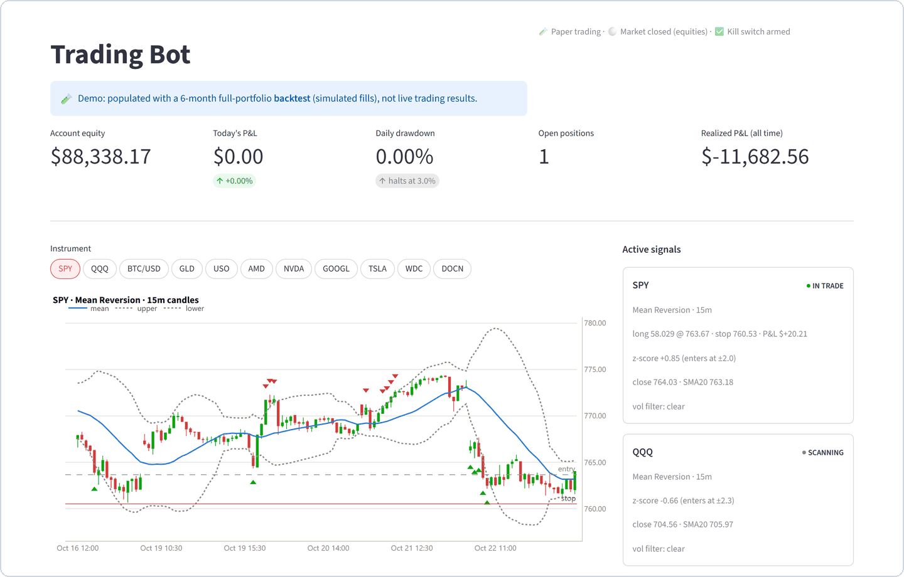
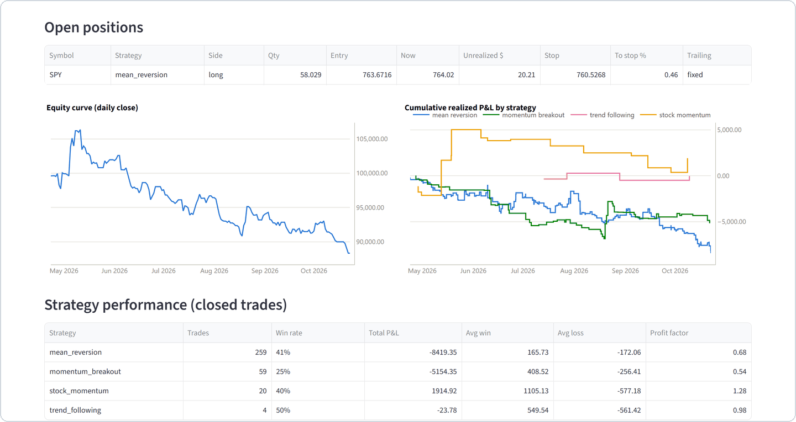
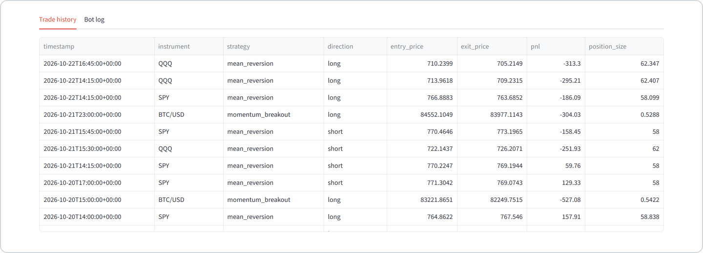

# Trading Bot

An automated, multi-strategy trading bot for the [Alpaca](https://alpaca.markets)
API. It runs several strategies simultaneously across equities, ETFs, and
crypto, with stop-based position sizing and portfolio-level risk controls.
**Paper trading by default** — it never touches the live endpoint unless
explicitly configured to.

Built on the official [`alpaca-py`](https://github.com/alpacahq/alpaca-py) SDK.

## Dashboard

A read-only Streamlit dashboard shows account status, live signals for every
instrument, open positions with their stops, the equity curve, P&L by strategy
and the full trade history. It computes indicators with the same code the bot
trades with, so what it shows is what the bot sees.

> **Note:** these screenshots show the dashboard populated with a 6-month
> full-portfolio **backtest** (Apr–Oct 2026, simulated fills), not live trading
> results. Candles and signals are live market data.

<picture>
  <source media="(prefers-color-scheme: dark)" srcset="docs/screenshots/dashboard-overview-dark.png">
  
</picture>

<picture>
  <source media="(prefers-color-scheme: dark)" srcset="docs/screenshots/dashboard-performance-dark.png">
  
</picture>

<details>
<summary>Trade history</summary>

<picture>
  <source media="(prefers-color-scheme: dark)" srcset="docs/screenshots/dashboard-trades-dark.png">
  
</picture>

</details>

## Engineering highlights

- **Fault-tolerant order handling.** Market orders carry a `client_order_id`,
  so a submit retried after a network error can't create a duplicate. Every
  fill is confirmed against the broker before it's recorded. Each position's
  exit is isolated, so one failing order can't block stop checks on the others.
- **Layered risk controls.** Stop-based sizing keeps per-trade risk at 1% of
  equity. Notional caps bound position size (0.5× equity per position, 1.0×
  total) regardless of stop width. A daily-drawdown kill switch and a
  correlation filter sit on top.
- **Crash-safe state.** State is written atomically (temp file + `os.replace`)
  after every change. On startup the bot reconciles against the broker's actual
  positions and orders, so a restart never leaves a position without its stop.
- **Data correctness.** Signals use completed candles only. Equity candles are
  rebuilt from the regular session and anchored to the 09:30 open, so thin
  pre/post-market prints can't distort indicators. Strategies wait until their
  indicators are fully warmed up.
- **Honest backtesting.** The backtester runs the *same* strategy classes as the
  live bot and fills at the next bar's open with slippage on every fill. Stops
  are checked intrabar and gaps fill at the worse price. Parameters are judged
  on a held-out period, against buy-and-hold, and on stock baskets chosen
  without hindsight.
- **Operations.** Runs 24/7 under `systemd` with auto-restart. A
  localhost-only Streamlit dashboard is reached over an SSH tunnel. Discord
  morning and evening reports retry with exponential backoff.
- **Tested.** A `pytest` regression suite that needs no API keys covers exit
  failures, sizing caps and session candle building.

### Postmortem: the unmanaged SPY position (Sept 2026)

During paper trading, an SPY mean-reversion position sat open for three weeks
at about 3.4× leverage and was down ~6% of equity at its worst. The bot never
checked its stop. The broker's order history, compared against the bot's
state file and logs, showed why:

1. **Fills at the open took minutes, but the bot waited 60 seconds.** Paper
   market orders placed at the 09:30 open filled 3–5 minutes later. The SPY
   entry timed out, so the bot never recorded a position it actually held. It
   had no stop or exit on it and nothing to manage. Exits on TSLA and USO timed
   out the same way, so those positions stayed in the bot's state after they
   had closed.
2. **A failed exit retried forever.** Each retry against an already-closed
   position got Alpaca `40410000` ("position not found"). The exception
   aborted the whole loop iteration, which skipped stop checks and candle
   evaluation for every other instrument.
3. **No cap on position size.** Stop-based sizing on a tight 15-minute stop
   asked for ~$345k of SPY on a ~$100k account. Only margin buying power
   bounded it.
4. **Pre/post-market bars in the indicators.** Their tiny ranges deflated ATR,
   which tightens stops and inflates position size.
5. **A request with no timeout.** The bot's state file stopped updating on
   Sept 22, and the bot stayed silent for two days. The broker SDK sends HTTP
   requests without a timeout, so one stalled request can block the loop
   indefinitely.

**Fixed:** isolated per-symbol exits, "position not found" treated as already
closed, no resubmission while an exit is pending, notional caps shared by the
live bot and the backtester, and regular-session-only candles. Each fix has a
regression test.

**Still open:** recording an entry whose fill confirms late (#1), and request
timeouts (#5). The bot stays offline until both are fixed.

### What the backtests show

The strategies are textbook starting points, and the backtester is used to
check them, not to sell them. Over the tested windows, **none reliably beats
buy-and-hold**:

- Mean reversion on SPY/QQQ loses money overall after slippage on every
  timeframe tested (15 minutes to 2 hours). Its short side lost in every test.
- The momentum breakout on BTC wins about a quarter of its trades and loses
  overall.
- Stock momentum gained +80% over 2020–2026 on its six configured stocks.
  On a 24-stock basket chosen without hindsight it gained only +6%, while SPY
  buy-and-hold gained ~+135%. Its edge came mostly from stock selection.
  Its genuine strength was drawdown control: −1% to −3% in 2022, when the
  stocks fell 25–56%.

This is the reason the project is paper-only.

## How it works

Each instrument is mapped to a strategy entirely in [`config.py`](config.py),
so adding or removing an instrument is a one-line change with no strategy-code
edits. All strategies evaluate signals only on **completed candles**, and no
strategy trades until its indicators are fully warmed up from historical data
fetched on startup. Equity candles use the **regular session only** (09:30–16:00
ET, anchored to the open — e.g. 4-hour candles are 09:30 and 13:30); thin
pre/post-market bars are excluded so they can't distort SMA, standard deviation
or ATR. Crypto uses 24/7 candles.

| Strategy | Instruments | Timeframe | Entry / exit | Stop |
|---|---|---|---|---|
| **Mean Reversion** | SPY, QQQ | 15 min | Enter when price closes beyond ±z·σ of the 20-period SMA (z = 2.0 SPY / 2.3 QQQ); exit at the SMA. Skips entries during volatility spikes. | 2× ATR, fixed |
| **Momentum Breakout** | BTC/USD | 1 hour | Long on a close above the 20-bar high with ≥1.5× average volume; exit to flat on a confirmed breakdown. Long/flat only (spot crypto can't be shorted). | 2× ATR, trailing |
| **Trend Following** | GLD, USO | 4 hour | Long on a 50/200 EMA golden cross; reverse to short on a death cross. | 3× ATR, trailing |
| **Stock Momentum** | AMD, NVDA, GOOGL, TSLA, WDC, DOCN | 4 hour | Donchian breakout adapted for single stocks: 20-bar-high breakout with volume, plus a 50-EMA trend filter and an earnings-blackout window. Long/flat. | 3× ATR, trailing |

## Risk management

- **Stop-based sizing** — every position is sized so that a move from entry to
  the initial stop equals exactly **1% of account equity**. Wider stops mean
  proportionally smaller positions; risk per trade stays constant.
- **Notional caps** — stop-based sizing alone can produce very large positions
  when the stop is tight, so dollar size is capped separately: no single
  position may exceed **0.5× equity**, and all open positions combined may not
  exceed **1.0× equity** (no margin). A new entry is scaled down to fit, or
  skipped if there's no room.
- **Trailing stops** recalculate ATR on each completed candle, trail from the
  extreme since entry, and never move against the position. Triggers are checked
  on every price update, not just on candle close.
- **Correlation filter** — if SPY and QQQ are both long, new BTC/USD longs are
  blocked to avoid doubling up on risk-on exposure.
- **Kill switch** — if the day's drawdown (realized + unrealized) exceeds 3% of
  equity, all new entries halt for the rest of the day; existing positions keep
  their stops.
- **State recovery** — on startup the bot reconciles with Alpaca (open positions
  and orders), resumes managing them, and persists all state to `state.json`
  after every change, so a crash or restart never orphans a position.
- **Fault-isolated exits** — each symbol's stop check runs independently, so a
  failed exit on one position can't block stops on the others. If Alpaca
  reports a position is already gone, the exit is recorded and the position
  dropped; an unconfirmed exit is re-checked rather than resubmitted.

All per-strategy risk parameters and the portfolio-level thresholds are
configurable in [`config.py`](config.py).

## Project structure

```
bot/
  strategies/
    base.py               shared indicators + Strategy/Signal interfaces
    mean_reversion.py
    momentum_breakout.py
    trend_following.py
    stock_momentum.py
  risk_manager.py         sizing, trailing stops, correlation filter, kill switch
  portfolio.py            all Alpaca API access (data, orders, retries)
  state.py                JSON state persistence + trade/PNL CSV logs
  backtest.py             historical backtester with slippage modeling
  main.py                 orchestrator / main loop
tests/                    pytest regression tests (exits, sizing caps, session candles)
docs/screenshots/         dashboard screenshots used in this README
config.py                 instrument→strategy mapping + all parameters
dashboard.py              Streamlit monitoring dashboard
morning_briefing.py       Discord morning briefing (scheduled)
evening_report.py         Discord evening report (scheduled)
deploy/                   systemd service files
DEPLOY.md                 24/7 cloud deployment runbook
```

## Setup

```bash
python -m venv .venv
.venv/bin/pip install -r requirements.txt      # Windows: .venv\Scripts\pip
cp .env.example .env                            # then fill in your Alpaca keys
```

Get **paper** API keys at the [Alpaca dashboard](https://app.alpaca.markets)
(switch the account picker to Paper → API Keys). The bot defaults to the paper
endpoint (`PAPER = True` in `config.py`).

## Usage

**Backtest** a strategy against historical data (read-only — safe to run
anytime, never places orders):

```bash
python -m bot.backtest --months 6 [--slippage 0.0005]
```

Reports per-instrument and portfolio metrics (win rate, profit factor, max
drawdown, Sharpe, return), flags any strategy with a negative Sharpe, and saves
an equity-curve chart to `backtest_results.png`.

Options:
- `--max-position 0.5 --max-exposure 1.0`: override the notional caps for
  this run only (defaults come from `config.RISK`). Useful for comparing sizing
  rules side by side.
- `--save-baseline`: write per-strategy results to `backtest_baseline.json`,
  which `evening_report.py` compares live trades against. Re-run after changing
  strategy or risk parameters.

**Run the bot:**

```bash
python -m bot.main
```

**Run the tests** (no API keys needed):

```bash
python -m pytest tests
```

**Monitoring dashboard** (live positions, signals, and P&L; see
[screenshots](#dashboard)):

```bash
python -m streamlit run dashboard.py
```

## Deployment

For running the bot 24/7 on a cloud server (so it doesn't depend on a local
machine staying awake), see **[DEPLOY.md](DEPLOY.md)** — a step-by-step runbook
covering a small Linux VM, `systemd` services that auto-restart on crash/reboot,
and the Discord briefing schedule.

## Adding or removing an instrument

One line in `config.py`. For example, to trade NVDA with the stock-momentum
strategy:

```python
INSTRUMENTS = {
    ...
    "NVDA": {"strategy": "stock_momentum", "params": {"earnings_dates": ["2026-08-26"]}},
}
```

Remove a line to drop an instrument. Per-instrument `params` override the
strategy defaults. Restart the bot to apply.

## Disclaimer

This is a personal research and educational project for **paper trading**. It is
not investment advice, and nothing here guarantees profitability — backtested
and live results can and do differ. Review the code and understand the risks
before ever pointing it at a live account.
